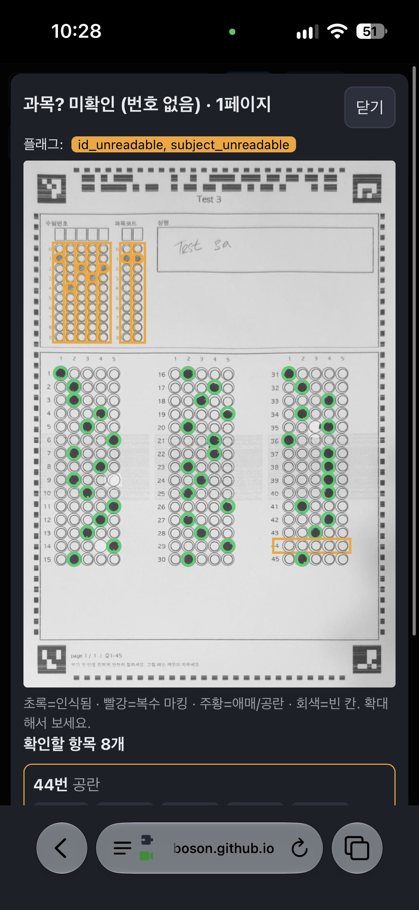

# StreamOMR

실시간(스트리밍) 카메라 OMR. 서버판(FastAPI + 파이썬 OMR)과 브라우저 단독판(Pyodide)이 있다.

**🔗 라이브 데모 (GitHub Pages): https://yngboson.github.io/streamomr/**

## 에이전트 핸드오프 / 작업 로그
다음 에이전트는 여기부터 읽을 것. 새 작업은 아래 로그 맨 위에 추가.

### 구조
- `omr/` 인식 코어, `app/` 서버(`scripts/serve.py`), `standalone/` 브라우저 단독판 소스
- `scripts/build_standalone.py` → `standalone/streamomr.html` 생성 (+ `app/static/standalone.html` 복사)

### 아이폰에서 테스트하는 법
iOS Safari 카메라는 **https에서만** 동작 (`file://` 불가).
1. **GitHub Pages (권장):** https://yngboson.github.io/streamomr/ → `standalone/streamomr.html`로 리다이렉트. Pages 소스는 `main` 브랜치 루트(`.nojekyll` 있음). 플로우: `build_standalone.py` 실행 → 커밋/푸시 → 1~2분 후 반영.
2. **같은 Wi-Fi:** `python scripts/serve.py --data data --https` → 폰에서 `https://<맥 LAN IP>:8443` (자체 서명 인증서 경고 통과 필요). 서버측 파이썬 OMR을 그대로 테스트.
3. **터널:** ngrok / `cloudflared tunnel --url https://localhost:8443`.

### 알려진 한계
- standalone은 완전 오프라인이 아님: `standalone/worker.js`가 Pyodide 0.27.7 + numpy/OpenCV(약 25MB)를 jsdelivr CDN에서 받음 (`build_standalone.py`의 `PYODIDE_BASE`). 진짜 오프라인화하려면 Pyodide를 레포에 번들해야 함.
- iPhone Safari에서 Worker 안 Pyodide 메모리 한계로 탭이 죽을 가능성 있음 — 실기기 검증 전.

### 로그
- 2026-10-14 (dev/e2): 인식기 속도 최적화(판독 결과 바이트 동일). 네이티브 ok 프레임 223→143ms(헤더 40→11, 점수 110→65, 트랙 45→39), bad_meta 243→138ms, 스트림 `feed` 융합 재판정 65→9ms. 변경: `decide_page`가 행별 절대판정·상대마크를 한 번만(벡터화 `_rel_rows`), 헤더 읽기를 `_box_means`로 벡터화하고 적분영상을 헤더 밴드만, 링 정렬(`_ring_offsets/_ring_scores`) 후처리 벡터화·패딩 제거, `omr/fastops.py`(`pct_rows`, `nanmedian0`: numpy와 비트 동일한 가벼운 대체), 잉크 p85 1회 계산, `trustworthy`가 recognize의 판정 서명 재사용. 검출(ArUco) 자체는 그대로라 partial 프레임(≈150ms)은 거의 불변 — 다음 과제는 ArUco 패스 수. 폰 환산 ≈3배.
- 2026-10-14 (E1, standalone 속도): 프레임당 비용을 분해해 보니(실기기 devlog) 인식 외에 파이썬 glue ~38ms(중앙값)와 메인스레드 grab+전송 ~26ms가 매 프레임 직렬로 붙어 있었음. 변경: (1) `glue.step_rgba` — 인식기는 gray만 쓰므로 RGBA→GRAY 직접 변환(BGR 중간 이미지 제거, 결과 바이트 동일), numpy 버퍼 재사용 + `JsProxy.assign_to`(프레임당 8MB 할당 3개 제거), (2) `app.js` 파이프라인 — 워커가 인식하는 동안 메인스레드가 다음 프레임을 미리 grab(`prefetch`, 160ms 넘게 묵으면 폐기·최신 프레임 우선, 큐 없음), canvas 크기는 바뀔 때만 재설정, Safari 0x0 가드 유지, (3) dev 빌드 `frames.csv` 끝에 11열 추가: grab_ms, frame_age_ms, xfer_ms, py_convert_ms, py_feed_ms, py_other_ms, worker_ms, post_ms, parse_ms, gap_ms, prefetched. 정확도 불변(photo 9/9, devlog 900/900, 테스트 337+1). 참고: 네이티브 기준 `session.feed`(융합 `decide_page`/`_relative_marks`)가 ok 프레임당 ~70ms — omr 쪽 최적화 후보.
- 2026-10-13 (dev/b): 시트 없는/가려진 프레임 비용 절감 (`omr/detect.py`). 실제 아이폰 로그에서 no_sheet/partial 프레임이 정상 판독보다 2배 느렸던 원인은 `find_markers`의 투기적 전체 프레임 패스(열기 사다리 + 조명 평탄화 + `_complete`). 변경: (1) 평탄화를 uint8 나눗셈으로(42→19ms, 몫은 float 유지 — 반올림하면 h_all 1프레임 손실), (2) 마커 후보가 전혀 없으면(`markerlike`: 검은 테두리+흰 여백 후보가 없고 평탄화본 1회 탐침에도 없음) 사다리/평탄화 생략, (3) 1~2개 마커가 시트 밖으로 나갈 것으로 예측되면(`_off_frame`) 즉시 종료. 네이티브 no_sheet 175→111ms(빈 책상은 더 큼, 노이즈 제외 20~75ms), 시도했던 '마커 2개면 사다리 생략'은 실영상 frm3 88→83%, 사진 9/9→7/9로 읽기 손실이 나서 폐기(이웃 스케일 패스 유지). partial(2마커, 다른 시트에 덮임)은 거의 불변(≈165ms) — `_complete` 창 탐색과 헤더 재시도(`_box_mean`)가 다음 최적화 과제. 판독률(photo 9/9 전 스케일·회전, 20개 커밋 프레임 truth 20/20 동일, header/geom/illum/marker 동일 이상), 폰 환산 ≈3배.
- 2026-10-13 (브랜치 `feature/scan-feedback`, 실험용 Pages https://yngboson.github.io/streamomr-research/ 에서 테스트 중, main 미병합): 커밋 피드백을 심각도별로 — `omr/identity.severity()`: 학번/과목 미인식·추정 = severe(빨간 테두리 + 낮은 3연 버저 + 긴 진동), 애매/복수/추정 답 = minor(앰버 테두리 + 2음), 정상 = 기존 초록 + 삑. 서버는 unassigned/rejected 결과도 severe. 비정상 커밋 후 배너의 "정정" 버튼 → 공용 상세 보기(`detail.js`)에 문항별 선지 버튼/공란, 학번·과목 자리별 0–9 버튼(`o.onFix`). 서버: 답은 `/api/submissions/{id}/override`, 학번은 `/assign`, 과목은 `/route`로 즉시 반영, `/api/scans/{id}/detail`이 submission_id와 이미 정정한 답(`fixed`)을 돌려줌. 단독판: 메모리 결과·목록·CSV(`fixed:` 플래그) 즉시 갱신. 테스트 324 통과(`tests/test_feedback.py` 추가). 브라우저/폰 실기기 미검증.
- 2026-10-13: 인수인계 — 개발용 로그 ZIP 실물 `streamomr-dev_2026-10-13-04-35-11.zip`(144MB, 스캔 21건·2494파일, 아이폰 research 테스트 페이지에서 받은 첫 실제 로그)은 **카메라 사진이 들어 있고 100MB 초과라 레포에 올리지 않음**(`docs/*.zip`은 .gitignore) — 사용자에게 파일을 따로 받아 `docs/`에 두고 볼 것. 아직 분석 안 함: 먼저 `log.txt`/`scans.csv`/`scans/*/trace.txt`를 보고 애매 판정 행의 fill%·strength·disc_dark를 정상 행과 비교할 것. 로컬 정리: 작업 폴더는 `streamomr`(main)과 `streamomr-research-pages`(research 레포 클론) 둘뿐; `research/accuracy` 브랜치는 이미 main에 병합됨(원격에는 남아 있음). research 페이지 갱신법: `python scripts/build_standalone.py --dev` → `standalone/streamomr-dev.html`을 research 레포의 `index.html`로 복사 후 푸시.
- 2026-10-13: 개발용 로깅 standalone (`python scripts/build_standalone.py --dev` → `standalone/streamomr-dev.html`, git 제외, **research 테스트 페이지(https://yngboson.github.io/streamomr-research/)에만 배포**; 일반 빌드/Pages/서버판은 변화 없음, `DEV=false`). `standalone/dev.js` + `glue.py`(`DEV`, `explain()`) + `omr/fusion.py`(`Track.apply`가 `out.trace_src`로 융합 측정치·프레임별 측정치 노출, 데이터클래스 필드 아님). 화면의 "개발용 로그" 카드에서 ZIP 하나로 다운로드(무압축 ZIP 직접 작성, 브라우저 실검증 전 — zip 구조는 파이썬 zipfile로 검증). 잘 읽힌 스캔까지 전부 기록: `log.txt`(STATE/STATUS/FAIL/COMMIT/TRACE/ROW 줄/STATS...), `scans.csv`, `frames.csv`(처리한 모든 프레임), `failures/`(시트가 보이는데 못 읽은 프레임 최대 60장), `scans/NNN_<수험번호>/{trace.txt,scan.json,sheet.jpg,sheet_marked.jpg,frame.jpg,crops/*}`. 행마다 선지별 마킹%(fill)·strength·disc_dark·다른 선지 대비 excess·ratio_to_max·t_in·절대규칙 분류, 융합 프레임별 min..max/sd, 절대규칙/상대규칙 판정, 임계값(ink, t_lo/t_hi, 학번용), 신뢰 여부, 사유 문장(why). 선지별 "확률"은 코드에 없어 fill(%)을 마킹%로 기록하고 conf는 행 단위 신뢰도임. 한계: frame.jpg는 확정 프레임이 아니라 확정 순간의 카메라 프레임.
- 2026-10-13 (브랜치 `research/accuracy`, main 미병합): 인식률 연구(think→search→think 3회, `RESEARCH.md`에 아이디어·출처·측정 기록). 유지: (A) 마커 3개일 때 4번째를 넓은 창(2.6변)에서 재탐색, 마커 2개면 아핀 예측으로 나머지 탐색(`detect._complete`/`_search_window`) — 말린 종이에서 3마커 예측이 1.6변까지 빗나감 확인. (B) 마커 4개로 geometry/헤더 실패 시 가장 안 맞는 마커를 빼고 1회 재시도(`recognize._worst_marker`, 소프트 플래그 `marker_dropped`). 결과: 헤더 curl 82→88%, raking 88→92%, h_all 65→68%; geom 판독 86.2→86.9%, 확실한 마킹 정확도 96.6→97.7%(curl 94.0→98.7%); 조용한 오류·학번 오독 불변, 실사진 9/9 유지, 시간 동일. 폐기: 마커 변 직선피팅 코너 보정(코너 오차 −10~20%지만 조용한 오류 +2씩), 헤더 한쪽 끝 등록(+0.2%). 다음 과제: 프레임 간 헤더 소프트비트 융합, 헤더 ECC(v3), 헤더를 아는 상단 트랙 DP.
- 2026-10-13: 서버판 결과 상세 + 확대 보기 — 서버 스캔 화면 "최근 스캔" 항목에 클릭 처리가 없어 시트 그림이 안 나오던 문제 수정. `GET /api/scans/{id}/detail`(저장된 result_json에서 버블 좌표·점수·판정) + 공용 `app/static/detail.js`(시트 전체 + 버블 색 링 + 문제 목록, standalone/app.js에 동일 블록 복사 — `OMR-DETAIL-SHARED` 마커, 동일성 테스트 있음). 불확실 문항/선지 탭 → 보정된 시트에서 해당 행을 클라이언트에서 잘라 최대 4배 확대(파란 링, "링 끄기"). 스캔/학생/충돌/미지정 화면 연결. 실제 브라우저·폰 화면은 미검증.
- 2026-10-13: 불확실 행 최선 추정 — 애매한 공란/약한 단일 마크 행과 학번·과목 자릿수에 `guess`/`guessed` 값을 채우고 플래그(`id_guessed`/`subject_guessed`/`guessed_answers`) 유지. 명백한 공란(Q44)은 공란. 추정 학번은 DB에서 `unassigned`(제안값 `suggested_id`), 추정 과목은 보류 시험. 스트림은 추정 ID를 증거로 쓰지 않음. 추정 정확도: 답 66–97%, 손상 프레임의 학번 44–50%.
- 2026-10-13: 복수마킹 유지 — 복수 마킹 행은 하나로 줄이지 않고 마킹 전체를 답으로 둠(추정 없음). 채점은 집합 비교(키 `[[0,1]]` = 정확히 {1,2}), 단일 키면 오답. CSV 플래그 `multi:Q,Q`, 답 칸 `1|2`, 학생/충돌 화면 "복수마킹" 태그. 전체 테스트 322, 실사진 9/9.
- 2026-10-12: 혼합 필기구(연필 학번 + 펜 답안, 답안 중간에 펜 교체) 대응 — 원인: 강도/채움이 페이지 전체 잉크 수준(펜 0.77)에 정규화돼 연필 마크(0.46~0.52)가 strength<0.6 약마크 취급, 엄격 자릿수 경로가 전부 ambiguous. `omr/ink.py local_levels`: 행별 잉크 수준을 이웃 행(답안 ±4/8/16, 학번·과목 블록은 한 구역) 마크 75퍼센타일로, 페이지 수준보다 15% 넘게 낮을 때만 낮춤(단일 필기구 시트는 수치 불변). `recognize.py`: 상대 규칙 게이트를 페이지 단위에서 영역 단위로(`_rel_trust_answers` ±7문항 창에서 강한 상대 마크(초과≥0.30) 40% 이상, `_rel_trust_digits` 학번 블록 자체 증거). 실사진(연필 학번) 14232/11/45문항 전부 판독, 기존 8장 유지(9/9, 1·0.5·0.33배), 연필 학번 합성 0→94%, 반펜/반연필 플래그 30→7.5%, faint/illum --ink/geom 조용한 오류 불변(illum --hard 3→2), 학번 오독 0, 전체 테스트 310. 폐기한 시도: 행 자체 마크를 수준으로(geom 조용한 오류 3→12), 창 중앙값(k_erase 0→9). 한계: 바닥(0.45×검정)보다 옅은 연필은 게이트 없으면 플래그, 행마다 무작위로 섞인 필기구는 일부 개선.
- 2026-10-12: 실사진 기준 세트 (realasset/*.jpeg 8장, 아이폰 24MP, 4등분 접힌 v2 시트 — 사진은 레포 미포함, 정답은 `realasset/truth.json` 형식, `scripts/photo_bench.py`/`tests/test_real_photos.py`). 3개 에이전트 병렬 후 통합: (1) `detect.find_markers_scaled` — 긴 변 1920px 초과 프레임은 축소본에서 마커 검출 후 원본에서 코너 보정 (24MP 548→~210ms), `_box_mean` clip 제거; (2) `detect._complete` — 마커 3개만 찾으면 4번째 예상 위치를 좁은 창에서 재탐색(45° 회전/번진 마커); 자기 페이지 마커와 겹치는 다른 페이지 마커 무시(`mixed_page_markers` 오판 제거); (3) `_fit_alignment` — 트랙으로 평탄화되고 링 인라이어 ≥0.8이면 최대 이동 허용 2→4mm. 결과: 5/8 → 8/8 (scale 1/0.5/0.33, 회전 90/180/270), 최대 ~250ms. 전체 테스트 302 통과, 학번 오독 0. geom/illum 벤치: 판독률↑, 조용한 오류 +1씩(새로 구제된 프레임의 흐린 마크 문항 — 흐린 마크 규칙 쪽 과제). 24MP JPEG 디코드(280–550ms)는 recognize 시간에 미포함.
- 2026-10-12: 접힌/말린 종이 대응 — 시트 4변에 타이밍 트랙(검은 눈금, 6mm 피치, 좌우 40개·상하 26개) 추가, 헤더 version 2로 구분(`Template.tracks` 기본 True, `tracks=False`는 기존 v1 그대로, 옛 레이아웃/인쇄런은 트랙 없음으로 로드). `omr/tracks.py`가 코너마커 워프 위에서 눈금을 DP로 추적해 네 변 변위를 Coons 패치로 보간하고 캔버스를 평탄화한 뒤 기존 링 정렬/판정 사용. 링 확인 실패 시 `alignment_unverified`, 행 단위 링 점검으로 국소 휨은 애매 처리, 트랙 미검출 시 기존 2차 모델 폴백. `scripts/geom_bench.py`(fold/fold_curl/fold_hand/fold_big) 전→후: 판독 프레임 fold 72→90%, fold_curl 62→78%, curl 60→85%, raking 68→92%, fold_big 정확도 71→96%, 학번 오독 0 유지, 실영상 회귀 없음. 한계: 가장자리 25mm 이내 접힘은 검토 표시만, 상하 눈금은 가장자리 4.4mm(프린터 클리핑 가능), 서버 UI에 tracks 옵션 없음.
- 2026-10-12: 약한 연필 마킹(반사 아래 ~20% 어두움) 상대 규칙 — 같은 문항의 다른 선지 중앙값보다 원 전체 어두움(`_mean_dark`, 원이 고르게 어두울 때만)이 0.15 이상 크면 마킹(`omr/recognize.py` `_relative_marks`/`_decide`). 절대 규칙이 확신 못 한 행에만 추가, 0.15~0.20은 플래그, 2개 이상이면 multi. 지우개 흔적과 구분이 안 돼 `_rel_page_trust`(문항 40% 이상이 상대 마크, ghost 거의 없음)일 때만 켬. `scripts/faint_bench.py`: faint 정독 64.8→99.8%, 조용한 오류 219→0, 학번 0→71%(오독 0). **알려진 문제: 반사가 시트 일부에만 있으면 40% 조건을 못 넘어 규칙이 꺼짐 — 영역 단위 게이트 필요.**
- 2026-10-12: 조명에 약한 헤더 인식 개선 (`scripts/header_bench.py`로 조건별 헤더 디코드율 측정, 합성 40프레임/조건, 전→후). 진단: 실패 대부분은 밝기 문제가 아니라 마커 3개만 보여 외삽된 호모그래피 때문에 헤더 한쪽 끝이 2~3mm 어긋나 `header_reg_mm` 검사에서 탈락한 것. 변경: (1) `recognize._flatten_header` 열 단위 종이 밝기 평탄화(효과 작음, 유지), (2) 1차 실패 시 탐색창/허용오차를 넓힌 재시도 + 행을 따라가는 `_track_dy`(CRC-16이 판정, 성공 시 `header_wide`/`header_tracked` quality 플래그), (3) `detect.flatten_lighting` 마커 검출 최후 수단 패스(마커 후보가 보일 때만 실행해서 빈 화면 비용 불변). 결과: shadow 78→100%, glare 88→100%, h_multi 68→88%, h_dimgrad 42→90%, h_all 28→52%, curl 52→62%, raking 55→62%. clean/dark 100% 유지, 전체 테스트 249 통과. 남은 실패: curl/raking/h_all은 조명이 아니라 종이 휨 + 마커 3개 외삽(헤더가 5mm 이상 기울어짐) — 비선형 보정이 필요. 서버판/standalone 모두 같은 `omr/`를 쓰므로 standalone은 재빌드함.
- 2026-10-12: standalone "최근 스캔" 항목을 탭하면 상세 모달(`#detail`)이 열림. `standalone/glue.py::detail()`이 커밋 시 보정된 시트(JPEG base64)와 문항/학번/과목별 버블 좌표·점수·판정을 내려주고, `standalone/app.js`의 `showDetail/renderDetail/drawSheet`가 시트 전체를 한 캔버스에 그리고(크롭 없음) 모든 버블에 색 링 + 문제 행에 박스, 아래에 문제 항목 목록(초록=인식됨, 빨강=복수마킹, 주황=애매/공란)과 선지별 농도(%)를 표시. **브라우저 실기기 렌더링은 미검증**(파이썬 쪽 detail()과 JS 문법만 확인). 서버판 `app/static/scan.js`에는 아직 없음.
- 2026-10-12: GitHub Pages 배포 경로 정리(루트 `index.html` 리다이렉트 추가), 이 핸드오프 섹션 작성. 아이폰 실기기 테스트는 아직 안 함.
- 2026-10-15: 순수 JS 단일 HTML 버전 (`web/`, 브랜치 `dev/js`). Pyodide/파이썬 없이 인식기 전체를 JS로 재작성: `web/src/*.js`(cv.js·aruco.js = OpenCV 필요 부분 + ArUco DICT_4X4_50 검출기, 나머지는 `omr/*.py` 1:1 포팅, 함수마다 원본 위치 주석), `web/src/scanner.js` = `standalone/glue.py`, `web/worker.js`·`app.js`·`dev.js`·`template.html`(기존 standalone과 같은 메시지 프로토콜/UI). 빌드 `python scripts/build_web.py [--dev]` → `web/streamomr.html`(약 400KB, 외부 요청 0). 검증(jsc = `/System/Library/Frameworks/JavaScriptCore.framework/Versions/A/Helpers/jsc`, 실데이터는 `STREAMOMR_REALASSET` 또는 `realasset/`): `web/test/{logic,cv,pipe,app}/run.py` — 로직 모듈 출력 파이썬과 동일(1.6만 체크), ArUco id 99.3%·코너 p99 1e-4px, 파이프라인 필드 일치 실사진/devlog 100%·영상 99.14%·합성 99.12%(차이 목록·원인은 `web/test/pipe/STATUS.md`; 합성 1프레임은 헤더 마진 0.0005 타이로 JS만 bad_meta), 정답 대비 실사진 9/9·devlog 900/900. 속도(같은 Mac WebKit, 1080x1920 ok 프레임): Pyodide 빌드 ~645ms → JS ~385ms; jsc 클래스별 ok 386/partial 313/no_sheet 204ms. OpenCV 5.0 실제 동작(approxPolyDP 선분 거리, 비트 셀 ≥절반, float bilinear warp 등)은 `web/test/cv/STATUS.md`.
